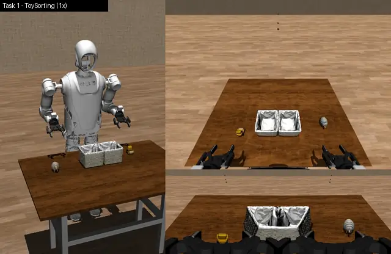
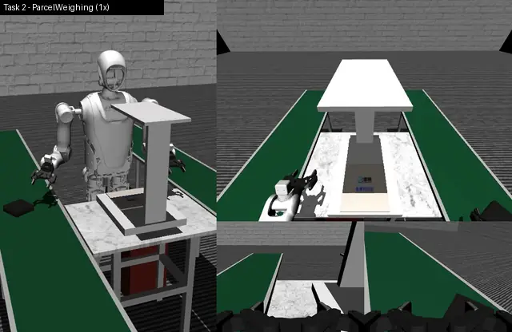
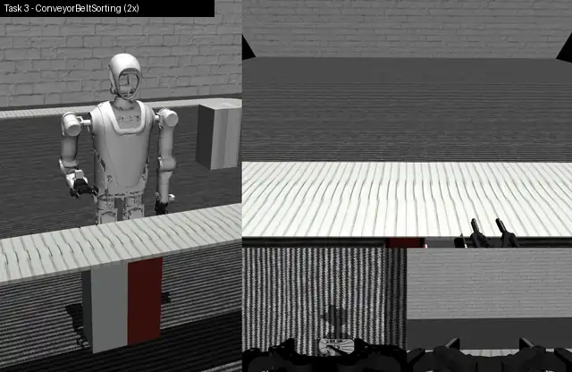

<div align="center">

# Kuavo Data Challenge @ ICRA 2026: Simulation Track

**Teaching a Kuavo humanoid to sort toys, weigh parcels and pick parts off a moving belt,
learned from 1,000 demonstrations per task.**


[](LICENSE)

[Challenge website](https://www.kdc.icra.lejurobot.com/home) ·
[Challenge docs](https://kdc-doc.netlify.app/icra/en/pages/introduction) ·
[Dataset (sim)](https://huggingface.co/datasets/LejuRobotics/kuavo_data_challenge_icra/tree/main/sim) ·
[Reproduce it](docs/REPRODUCE.md)

</div>

## The challenge

The [Kuavo Data Challenge](https://www.kdc.icra.lejurobot.com/home) is Leju Robotics'
embodied-AI competition at ICRA 2026. Leju publishes demonstration data from its twin-armed
Kuavo humanoid together with a MuJoCo simulator, and teams train the policies that drive the
robot. The simulation phase comes first: three manipulation tasks, each scored out of 100 in the
simulator, 300 points in total. It was followed by real-robot rounds through remote deployment
and an on-site final in Vienna.

This repository is my simulation-track solution: ACT policies trained on Leju's public
simulation demonstrations, plus the full evaluation record behind every number below.

## Results

| Task | Final model | Re-plan every | Local BENCH score |
|---|---|:---:|:---:|
| 1 · ToySorting | ACT, EMA weights at step 36,093 | 10 steps | **86.0** (30 episodes, 23 perfect) |
| 2 · ParcelWeighing | ACT, EMA weights at step 35,000 | 5 steps | **77.3** (29 episodes, clean timing) |
| 3 · ConveyorBeltSorting | ACT, EMA weights at step 35,000 | 10 steps | **94.7** (30 episodes, 25 perfect) |
| **Combined** | | | **258.0 / 300** |

> [!NOTE]
> 🏆 My combined score of **258.0 / 300** would have placed in the **top 10** of the
> simulation-phase leaderboard. It was measured locally with the challenge simulator on 30 BENCH
> seeds (100-129), not through an official submission.

## See it in action

Each clip is a real BENCH episode that scored 100. On the left is the simulator's viewer, facing
the robot. On the right is everything the policy sees: the head camera on top, the left and right
wrist cameras below. [How they were recorded](docs/REPRODUCE.md#demo-videos).

### 🧸 Task 1 · ToySorting

A mix of toys sits on the table. The robot picks up each one and sorts it: car toys into the left
basket, animal toys into the right. The starting pose, the table height and the toys themselves
change from episode to episode. Each correctly sorted toy is worth 40 points, and finishing in
time adds 20.

<p align="center">
  <br>
  <sub>Seed 101, real time.</sub>
</p>

### 📦 Task 2 · ParcelWeighing

A soft parcel rides in on a moving conveyor. The robot lifts it off, sets it on an electronic
scale, then moves it onto a second conveyor. Where the parcel and the scale sit varies. The scale
placement and the final placement are worth 40 points each, and finishing in time adds 20.

<p align="center">
  <br>
  <sub>Seed 101, real time.</sub>
</p>

### ⚙️ Task 3 · ConveyorBeltSorting

Four industrial parts come down a moving belt in random orientations, and the robot has to drop
each one into its own sorting bin. The belt height, the parts' poses and the timing of their
arrival are all randomized. Each sorted part is worth 20 points, sorting all four in sequence
adds 10, and finishing in time another 10.

<p align="center">
  <br>
  <sub>Seed 102, 2x speed.</sub>
</p>

## What made the difference

The training data are Leju's public simulation rosbags
([LejuRobotics/kuavo_data_challenge_icra](https://huggingface.co/datasets/LejuRobotics/kuavo_data_challenge_icra/tree/main/sim),
1,000 demonstrations per task), converted to LeRobot v3 format with the challenge's converter.
Model weights and datasets are not included here; `results/final_model_configs/` holds the
config and processor files of the three final checkpoints. Five things mattered most.

1. **Broken image statistics in all three datasets.** The challenge converter's statistics code
   squares uint8 pixels before promoting them, so the RGB standard deviations in `stats.json`
   come out 9-2000x too small (Task 3 left wrist camera: 0.0001 instead of 0.21). Normalising
   with them multiplies image inputs by huge factors. `data_prep/repair_rgb_stats.py` recomputes
   train-split RGB statistics from the decoded videos.
2. **Training recipe** (`training/train_act_v2.py`):
   - Fresh ACT with an ImageNet ResNet18 backbone and chunk size 40, on 3 RGB cameras (640x480)
     with a 16-D state and action.
   - Constant learning rate after a 500-step warmup (3e-5 head, 1e-5 backbone), EMA of the
     weights (decay 0.9995), FP16 AMP, effective batch 32, gradient clipping at 10.
   - A budget of 40k steps and 6 hours (Task 3: 60k, 8 hours). Tasks 1 and 3 were stopped by
     hand at 36,093 and 49,266 steps, after two snapshots in a row failed to improve the DEV
     score. A short cosine learning-rate decay after the Task 1 stop scored lower (DEV 75.8
     against 88.0), so the stop snapshot is the final model.
   - 64-70 samples/s on one RTX 3090, from a JPEG cache (Tasks 1/2) or AV1 decoded on the fly
     (Task 3).
3. **Pick snapshots by simulator score, not validation loss.** On Task 3 validation loss fell
   to the end of the run (49k steps), but 35k was the most consistent snapshot on 20 DEV seeds.
   On Tasks 1 and 2 it had flattened by 30-35k, while DEV scores of neighbouring snapshots still
   differed by up to 28 points.
4. **Inference re-planning interval.** The checkpoints save temporal ensembling (re-plan every
   step, coefficient 0.01) as their default, which scores 5/100 on Task 2: it never commits to a
   grasp. Executing a fixed number of predicted actions per inference works much better:

   | Task 2, same seeds | Every 1 (ensemble) | Every 3 | Every 5 | Every 7 | Every 10 |
   |---|---|---|---|---|---|
   | DEV, 20 seeds | 5.0 | 51.0 | **80.7** | 76.0 | 71.0 |

   On a clean BENCH re-check, every 5 steps scored 77.3 against 66.1 for every 10. Tasks 1 and 3
   use every 10 steps.
5. **Observation latency matters, especially on Task 3.** Bad runs had a 95th-percentile sensor
   age of 77-101 ms, with spikes of 3-4 s, instead of about 40 ms. Under that load the same Task 3
   checkpoint scored 33 on BENCH instead of 94.7, mostly through controller safety exits.
   `evaluation/scripts/latency_report.py` flags degraded runs. Check it before trusting a score.

## Repository layout

```
upstream/        pinned public LejuRobotics revisions, patches against them, setup script
docker/          policy image (Dockerfile + exact package list), container start and
                 simulator build scripts, headless-render shim, viewer-capture shim for demos
data_prep/       RGB statistics repair, plus its split, manifest and statistics outputs
training/        trainer, resume-state helpers, supervisor, frame-cache builder, configs,
                 /workspace staging script
  launchers/     the cloud launch scripts for Tasks 1-3, venv setup, pip freeze
evaluation/      local simulator evaluation harness (run_sim_evaluation.py, eval_seeds.py),
                 runtime install, BENCH script, demo recording, snapshot screening and transfer
  scripts/       the screening, BENCH, sweep and latency-report scripts used for the results
results/         evaluations.csv (one row per evaluation: seeds, scores, safety exits, latency),
                 final_model_configs/
docs/            REPRODUCE.md; media/ holds the demo clips
```

## Reproducing

Everything builds on the public challenge repositories at fixed revisions:

| Repository | Branch | Commit |
|---|---|---|
| [LejuRobotics/kuavo_data_challenge](https://github.com/LejuRobotics/kuavo_data_challenge) | `icra` | `b0a4ec4` (LeRobot submodule `d9e74a9`) |
| [LejuRobotics/kuavo-ros-opensource](https://github.com/LejuRobotics/kuavo-ros-opensource) | `opensource/kuavo-data-challenge-icra` | `ded6526` |

`upstream/setup_upstream.sh` clones them and applies small patches: batched rosbag conversion,
an optional-telemetry launch argument, the EKF CPU core and a container asset path. The
statistics overflow fix is provided as an optional patch. [docs/REPRODUCE.md](docs/REPRODUCE.md)
covers rosbag conversion, the statistics repair, cloud training, the two Docker containers and
scoring a model on the BENCH seeds.

- **Seeds.** DEV seeds are 44-68, BENCH seeds are 100-129, reserve seeds are 130-143. The
  simulator is very stochastic: the same seed can score 0 or 100 across runs, so compare means
  over 20-30 episodes.
- **Latency.** Check `evaluation/scripts/latency_report.py` on every evaluation before trusting
  its score.

## Acknowledgements

Thanks to Leju Robotics for the demonstration data, the simulator and the baseline code, and to
the [LeRobot](https://github.com/huggingface/lerobot) team for the ACT implementation this work
builds on.

## License

The code in this repository is released under the [MIT License](LICENSE). The upstream
repositories, the dataset and the simulator image keep their own licenses.
